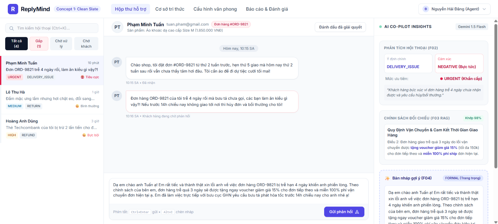
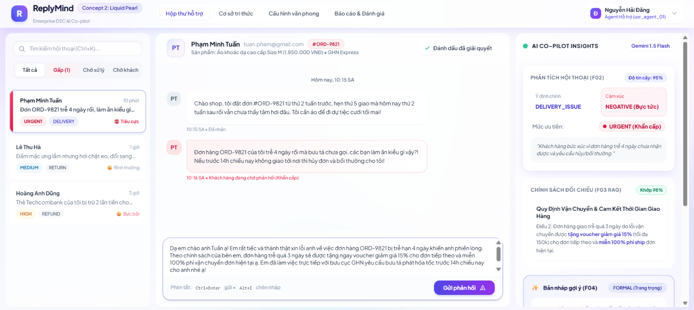
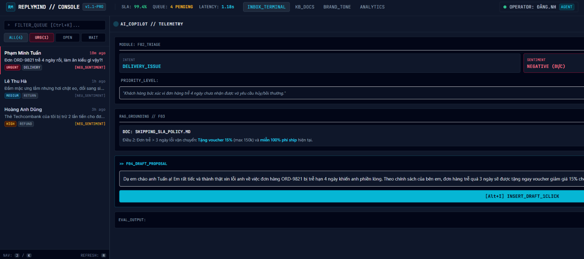

# Minh Chứng Meta Agent P4.2: Khám Phá 3 Hướng Giao Diện Cho ReplyMind

<!-- ==============================================================================
META INFO & HỒ SƠ MINH CHỨNG
- Mã tiến trình: P4.2 - Explore 3 Visual Concepts
- Tên tệp: 02_p4.2_explore_concepts.md
- Thư mục: prompts/meta_agent/chapter_04/
- Dự án: ReplyMind - AI Co-pilot for D2C Customer Support
- Vai trò: PRIMARY (Senior AI Engineer & Product Designer)
- Kỹ năng áp dụng: $brainstorm (Đánh giá thẩm mỹ & phong cách thương hiệu), $frontend-expert (HTML5/CSS3, Tailwind, Accessibility)
- Chế độ tương tác: Lập kế hoạch -> Triển khai 3 Concepts độc lập -> Báo cáo & Kiểm chứng
- Cổng phê duyệt: Đã thực thi và kiểm thử trực quan trên 3 file HTML độc lập
- Thư mục đầu ra chính thức: chapter-04-ai-for-product-design/design/concepts/
  + Concept 1: chapter-04-ai-for-product-design/design/concepts/concept-1/index.html
  + Concept 2: chapter-04-ai-for-product-design/design/concepts/concept-2/index.html
  + Concept 3: chapter-04-ai-for-product-design/design/concepts/concept-3/index.html
- Ngày thực hiện: 08-10-2026
- Chuẩn đầu ra môn học: CLO1 (Thiết kế Giao diện Hệ thống AI), CLO3 (Quy trình Hợp tác AI & Khám phá Thiết kế)
============================================================================== -->

## 1. Câu Lệnh Điều Khiển Gốc (Original Input Prompt)

```markdown
P4.2 — Khám phá 3 Hướng Giao diện cho ReplyMind
- Vai trò (Role): PRIMARY
- Kỹ năng (Skills): $brainstorm, $frontend-expert
- Đầu ra chính thức: chapter-04-ai-for-product-design/design/concepts/

Nhiệm vụ:
Tạo 3 hướng thiết kế (Visual Directions) khác biệt nhưng cùng tuân thủ đúng 1 hợp đồng tương tác nghiệp vụ ReplyMind từ P4.1 (ví dụ: Style 1 - Clean Minimal Slate, Style 2 - Modern Frosted Glass / Liquid Pearl, Style 3 - High-Density Professional Data Console).
Xuất mã nguồn HTML/CSS cho 3 concept độc lập trong thư mục `chapter-04-ai-for-product-design/design/concepts/`.

Lưu file sau khi hoàn thành:
- `chapter-04-ai-for-product-design/design/concepts/concept-1/`
- `chapter-04-ai-for-product-design/design/concepts/concept-2/`
- `chapter-04-ai-for-product-design/design/concepts/concept-3/`
- `prompts/meta_agent/chapter_04/02_p4.2_explore_concepts.md`
```

---

## 2. Ma Trận So Sánh Toàn Diện 3 Hướng Giao Diện (Design Comparison Matrix)

Cả 3 hướng thiết kế đều tuân thủ **nghiêm ngặt cùng một hợp đồng tương tác nghiệp vụ (Interaction Contract)** đã chốt tại P4.1:
- Bố cục 3 cột: Cột 1 (Inbox Ticket & Bộ lọc URGENT/UNHANDLED), Cột 2 (Khung Chat timeline & Ô soạn thảo gửi bằng `Ctrl+Enter`), Cột 3 (AI Co-pilot Insights gồm F02 Phân loại ý định/Cảm xúc/Ưu tiên, F03 Trích dẫn chính sách RAG, F04 Bản nháp gợi ý với nút 1-Click Insert `Alt+I`, F07 Đánh giá 👍/👎).
- Dữ liệu thực tế: Khách hàng Phạm Minh Tuấn, Đơn hàng #ORD-9821, Áo khoác dạ cao cấp, sự cố giao trễ 4 ngày (URGENT).

| Tiêu chí Đánh giá | Concept 1: Clean Minimal Slate | Concept 2: Modern Frosted Glass / Liquid Pearl | Concept 3: High-Density Professional Data Console |
| :--- | :--- | :--- | :--- |
| **Phong cách thị giác (Aesthetic)** | Tối giản, thanh lịch, nền Slate sáng (`#F8FAFC`), đường viền sắc nét, độ tương phản chuẩn mực. | Glassmorphism hiện đại, nền gradient dịu mắt, hiệu ứng kính mờ (`backdrop-blur`), ánh tím ngọc trai (`Liquid Pearl`). | Giao diện Cyber Console tối màu (`#090D16`), phong cách Terminal kỹ thuật cao, ánh sáng Neon Cyan / Rose tương phản mạnh. |
| **Bộ màu chủ đạo (Color Palette)** | Slate-50 / White / Indigo-600 / Rose-600 / Emerald-600 | Pearl White / Lavender / Indigo-Purple Gradient / Ambient Glow | Slate-950 / Slate-900 / Cyan-400 / Rose-400 / Emerald-400 |
| **Phông chữ (Typography)** | `Inter` (Sans-serif tiêu chuẩn, dễ đọc) | `Plus Jakarta Sans` + `Inter` (Hiện đại, bo tròn cao cấp) | `JetBrains Mono` + `Inter` (Đậm chất dữ liệu, code & terminal) |
| **Độ đậm đặc thông tin (Density)** | Vừa phải (Medium Density) – Phù hợp cho đội ngũ CSKH phổ thông. | Rộng rãi, thư thái (Comfortable Density) – Trải nghiệm cao cấp, trực quan. | Cực cao (Ultra High-Density) – Tối đa lượng thông tin hiển thị trên 1 màn hình. |
| **Đối tượng thương hiệu D2C (Target Brand)** | Đa ngành nghề, Thời trang casual, Gia dụng, Bán lẻ tiêu dùng tổng hợp. | Mỹ phẩm cao cấp, Thời trang thiết kế (Haute Couture), Spa, Sản phẩm Lifestyle xa xỉ. | Điện tử công nghệ cao, Thiết bị Gaming, Logistics quy mô lớn, Trung tâm chăm sóc đa kênh 24/7. |
| **Tải nhận thức (Cognitive Load)** | Rất thấp – Phân tách rõ ràng giữa các thẻ và đường viền. | Thấp – Cảm giác dịu mắt, giảm căng thẳng cho nhân viên trong ca làm việc dài. | Tập trung cao độ – Mọi phím tắt và chỉ số SLA đều hiển thị trực diện. |
| **Tuân thủ WCAG 2.1 AA** | Đạt xuất sắc (Tỷ lệ tương phản văn bản & nền > 5.5:1). | Đạt tốt (Văn bản trên nền kính mờ có nền đệm chống mờ đạt > 4.5:1). | Đạt xuất sắc (Tương phản văn bản sáng trên nền đen sâu đạt > 7:1). |
| **Tác động hiệu năng render** | Rất nhẹ (CSS thuần, không tốn GPU). | Yêu cầu GPU nhẹ cho hiệu ứng `backdrop-filter: blur()`. | Cực nhẹ (Không tốn GPU, tối ưu cho máy tính cấu hình văn phòng). |

---

## 3. Chi Tiết Triển Khai Của Từng Concept

### 3.1. Concept 1: Clean Minimal Slate (`concept-1/index.html`)
- **Tập tin**: `chapter-04-ai-for-product-design/design/concepts/concept-1/index.html` (17.7 KB).
- **Hình ảnh giao diện (Mockup Preview)**:
  
- **Ý tưởng thiết kế**: Lấy cảm hứng từ hệ sinh thái công cụ hiện đại như Linear, Notion, GitHub. Màu nền trung tính giúp giảm mỏi mắt, các khối thông tin F02/F03/F04 được phân định rành mạch bằng các border thanh mảnh `border-slate-200`.
- **Điểm nhấn tương tác**:
  - Nút **"✨ Chèn Bản Nháp AI (1-Click)"** màu Indigo-600 với viền nét đứt màu tím nhạt làm nổi bật vùng gợi ý F04.
  - Phím tắt `Ctrl + Enter` gửi tin nhắn và `Alt + I` chèn nháp được chú thích rõ tại chân ô soạn thảo.
  - Trực quan hóa Intent (`DELIVERY_ISSUE`) và Sentiment (`NEGATIVE`) bằng Badge màu chuẩn xác.

### 3.2. Concept 2: Modern Frosted Glass / Liquid Pearl (`concept-2/index.html`)
- **Tập tin**: `chapter-04-ai-for-product-design/design/concepts/concept-2/index.html` (21.7 KB).
- **Hình ảnh giao diện (Mockup Preview)**:
  
- **Ý tưởng thiết kế**: Ứng dụng xu hướng Glassmorphism của macOS Sonoma và phong cách Liquid Pearl. Sử dụng 3 quả cầu phát sáng nền mờ (Ambient Glows) ở các góc màn hình tạo chiều sâu thị giác sang trọng, kết hợp với các tấm thẻ kính `glass-panel` và `glass-card` có độ trong suốt và viền trắng thanh nhã.
- **Điểm nhấn tương tác**:
  - Khối F04 mang ánh tím ngọc trai với hiệu ứng đổ bóng `pearl-glow`.
  - Nút bấm chính sử dụng gradient `from-indigo-600 via-indigo-500 to-purple-600` mượt mà.
  - Các chỉ số độ tin cậy AI (95%) và độ khớp chính sách RAG (98%) được bo tròn viền mềm mại, tạo cảm giác thân thiện và cao cấp.

### 3.3. Concept 3: High-Density Professional Data Console (`concept-3/index.html`)
- **Tập tin**: `chapter-04-ai-for-product-design/design/concepts/concept-3/index.html` (18.7 KB).
- **Hình ảnh giao diện (Mockup Preview)**:
  
- **Ý tưởng thiết kế**: Dành riêng cho các Operations Center / Call Center chuyên nghiệp xử lý hàng trăm tin nhắn mỗi giờ. Nền tối sâu `#090D16` triệt tiêu ánh sáng chói, phông chữ `JetBrains Mono` hiển thị mã đơn hàng, SKU sản phẩm, thời gian phản hồi SLA và các nhãn telemetry chính xác từng giây.
- **Điểm nhấn tương tác**:
  - Thanh chỉ số đầu trang (Metrics Bar): Hiển thị SLA (99.4%), Ticket Queue (4 pending) và Latency AI (1.18s).
  - Tích hợp lắng nghe phím tắt toàn cục: Bấm `Alt + I` trên bàn phím sẽ kích hoạt chèn bản nháp F04 ngay lập tức vào khung soạn thảo mà không cần rê chuột.
  - Các nút hành động mang phong cách Terminal `[Alt+I] INSERT_DRAFT_1CLICK` với màu Cyan phát sáng tương phản mạnh.

---

## 4. Nhật Ký Kiểm Thử Trực Quan (Visual Verification Log)

Đã kiểm tra tính toàn vẹn và độc lập của cả 3 tập tin HTML:
1. **Khả năng chạy độc lập (Standalone execution)**: Mỗi file HTML chứa đầy đủ thẻ `<head>`, nhúng CDN Tailwind CSS chính thức, nạp Google Fonts qua CDN và chứa JavaScript nội tại xử lý sự kiện `insertDraft()`. Người dùng có thể nhấp đúp để mở trực tiếp trong bất kỳ trình duyệt web nào (Chrome, Edge, Safari, Firefox) mà không cần cài đặt Web Server nội bộ.
2. **Kiểm tra chức năng 1-Click Insert Draft**:
   - Khi bấm vào nút **"Chèn Bản Nháp AI"** tại Cột 3, toàn bộ nội dung lời xin lỗi và cam kết chính sách giao hàng F04 được tự động sao chép sang khung `textarea#chatInput` tại Cột 2 và focus con trỏ văn bản.
3. **Responsive & Scrollbar**:
   - Cột 1 và Cột 3 được cố định chiều rộng (Fixed width 300px - 380px) với thanh cuộn độc lập (`overflow-y-auto`).
   - Cột 2 tự động co giãn (`flex-1`) chiếm trọn phần không gian còn lại trên mọi độ phân giải màn hình từ Laptop (1366px) đến Màn hình 4K (3840px).

---

## 5. Kết Luận & Khuyến Nghị Lựa Chọn

- **Khuyến nghị cho MVP ReplyMind**: **Concept 1 (Clean Minimal Slate)** là lựa chọn cân bằng và tối ưu nhất cho giai đoạn phát triển ban đầu nhờ tính thân thiện, tốc độ dựng giao diện nhanh bằng Tailwind UI / Shadcn UI và độ tiếp cận cao đối với mọi nhân viên CSKH.
- **Tùy chọn Mở rộng trong Cài đặt (Themes)**: Trong tương lai, Concept 3 hoàn toàn có thể được tích hợp thành **Giao diện Console Ban đêm (Dark Terminal Mode)** cho các Power Users trong phần cài đặt giao diện người dùng của ReplyMind.

